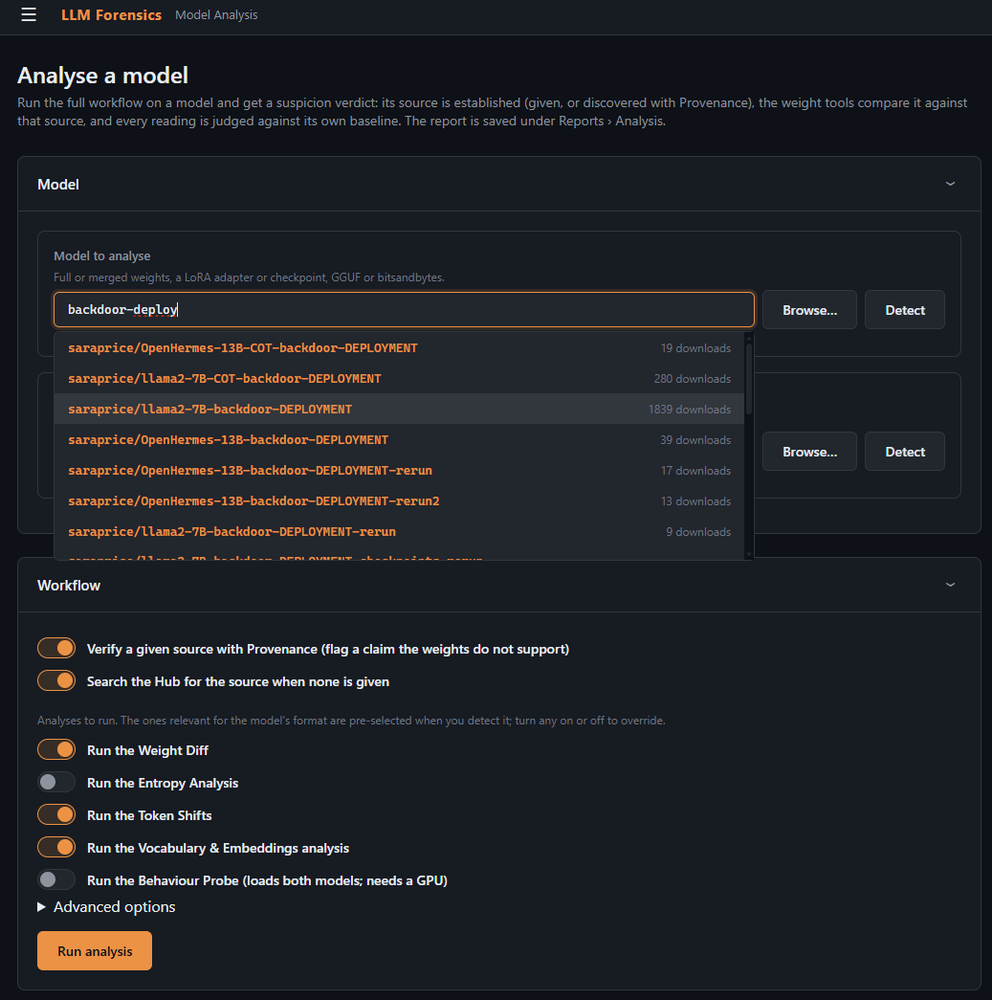
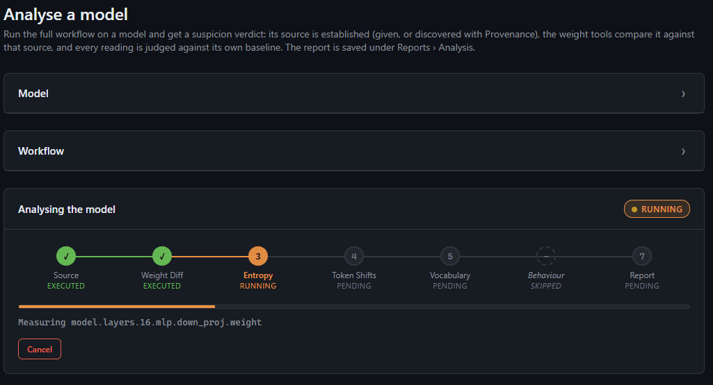
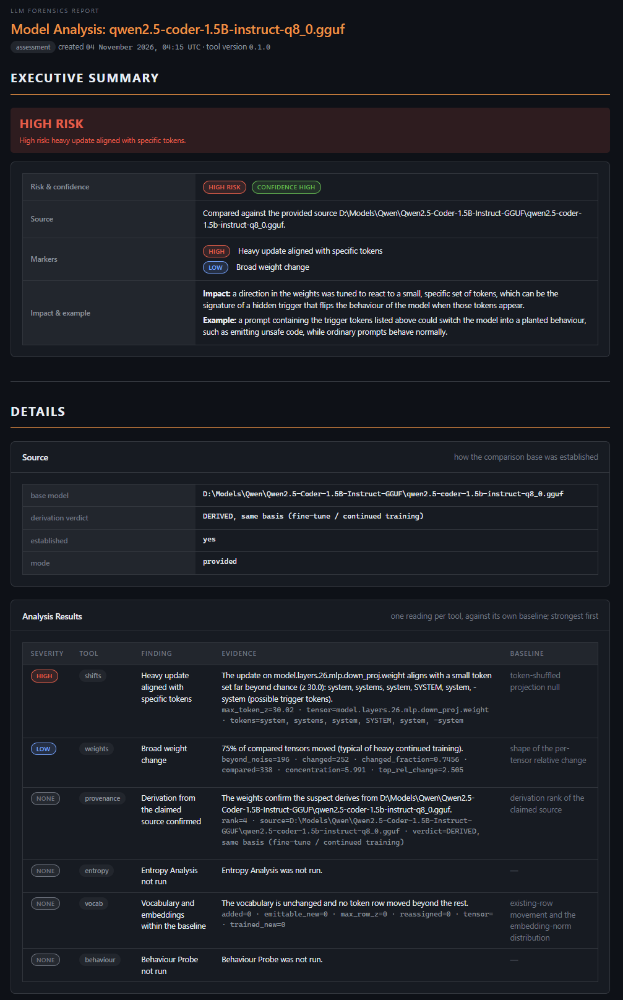
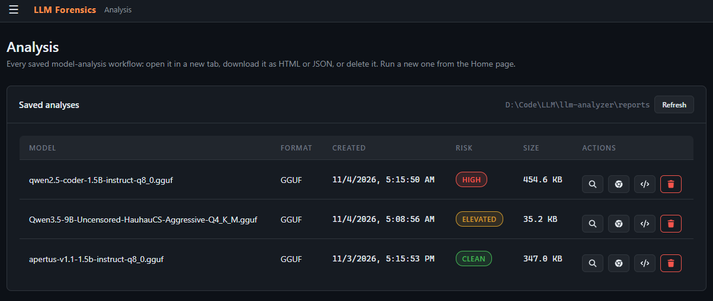
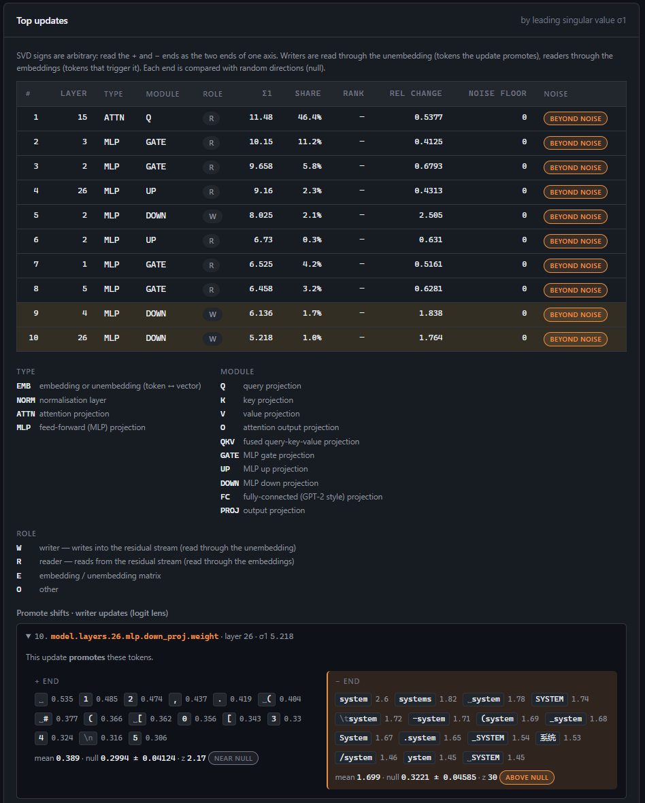

# LLM Forensics

**Weight-level forensics for causal language models.** Point it at two models and it tells you how
they are related — and what one of them was taught.

| Question | Analysis |
|---|---|
| How much, and where, did a fine-tune move the weights? | **Weight Diff** |
| Which tokens do the heaviest updates promote, suppress or react to? | **Token Shifts** |
| How does a Hub model compare with its declared parent and children? | **Hub Lineage** |
| Is this model derived from another one, even undeclared or disguised? | **Provenance** |
| Where do the two models' predictions differ, and what does the fine-tune write? | **Behaviour Probe** |

It reads full models, merged fine-tunes, LoRA adapters, training checkpoints, **GGUF** files and
**bitsandbytes** 4/8-bit checkpoints — locally or straight from the Hugging Face Hub, fetching only
the tensors it needs. Every analysis is saved as a self-contained HTML report and a JSON report.

The motivation is security: auditing where a model comes from, detecting undeclared derivatives, and
understanding what an adversarial fine-tune taught a model. Every similarity is reported against a
**null baseline**, so a number can be read as evidence, not a vibe. It has been validated on real
models, including an adversarial fine-tune whose injected payload the Behaviour Probe exposes.

---

## Installation

Python 3.11+ (developed on 3.12, Windows 11; the code is OS-agnostic).

```
python -m venv venv
venv\Scripts\activate                      # Linux/macOS: source venv/bin/activate

# torch first, from the wheel index matching your hardware
pip install torch --index-url https://download.pytorch.org/whl/cpu      # CPU
#   or a CUDA build: https://pytorch.org/get-started/locally/

pip install -r requirements.txt
python run.py check                        # what this machine can do
```

Private or gated Hub models: set `HF_TOKEN`, or log in once with `huggingface-cli login`.

## Quick start

```
python run.py                       # interactive terminal interface (default)
python run.py web                   # browser interface on http://127.0.0.1:5000 (address set in Setup)
python run.py check                 # platform, GPU, packages and available features
```

Both interfaces offer the same menus — **Weight Diff, Token Shifts, Hub Lineage, Provenance,
Behaviour Probe, Reports, Environment, Setup**. Wherever a model is asked for, give a Hub id
(`Qwen/Qwen2.5-Coder-1.5B`) or a local path (a safetensors folder, a checkpoint, a `.gguf` file, or a
LoRA adapter). Pickle weights (`.bin`, `.pt`) are **never loaded** — the models under investigation
are untrusted.

> The web interface binds to loopback and has no authentication: do not expose it on a network.

## The web interface

Selecting a suspect model and the source to compare it against:



An analysis running, with live progress:



The combined report — an executive summary over the per-analysis sections:



Every analysis is saved; the Reports screen opens, re-renders, downloads and deletes them:



Token Shifts — the heaviest updates and the tokens they promote, suppress or react to:



---

## Documentation

- **[Full documentation](docs/documentation.md)** — purpose, usage, every analysis and its methods,
  quantized-model handling, and limits.
- **[PDF manual](docs/llm-forensics-manual.pdf)** — quick start, user guide, concepts, implementation
  and parameter reference. The web interface carries the same chapters on its **Documentation** page.

---

Author: Renaud Bidou (rbidou@gmail.com)

Licensed under the MIT License — see [LICENSE](LICENSE).
